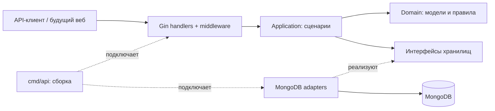

# 01. Архитектура

> Реализация готова: актуальные команды в [README](../README.md). По запросу пользователя при старте добавлен одноразовый импорт демоданных Астаны вместе с demo admin. Техническая коллекция app_meta хранит маркер импорта. Основной compose.yaml расположен в корне. Ниже сохранены проектные решения с уточнениями реализации.


## Модульный монолит с Clean Architecture

Один Go-бинарник обслуживает REST API, HTML и статические файлы React. MongoDB хранит все данные. Redis, очередь, микросервисы и отдельный ML-сервис пока не нужны.

Уточнение от 12 ноября 2026: Assignment #6 сдан. Реализован React + TypeScript frontend, сборку которого раздаёт Go. Фактические файлы, запуск и устройство веба — [документ 18](18-frontend-guide.md), исходный план — [обзор 12](12-frontend-plan.md). Ниже `web/templates`/`web/static` отражают прежний предварительный вариант; в реализации используются `web/src`/`web/dist`. Backend-слои сохранены.



Стрелки HTTP → Application → Domain описывают зависимости исходного кода. Application вызывает интерфейсы, а конкретные MongoDB-адаптеры получает через конструкторы. Во время выполнения запрос доходит до MongoDB через эти реализации.

## Модули

| Модуль | Ответственность |
|---|---|
| `identity` | Регистрация, вход, сессии, профиль, роли |
| `catalog` | Места, категории, поиск, геофильтры, CRUD |
| `activity` | Избранное, оценки, просмотры, выбор места, история |
| `recommendation` | Только на файнале: расчёт сходств и рекомендаций |

Модуль `activity` проверяет существование места через небольшой порт `PlaceReader`, который реализует адаптер каталога. Не импортируем чужие HTTP-обработчики или внутренности MongoDB-репозиториев. Не создаём универсальный CRUD-репозиторий на все сущности: операции должны соответствовать сценариям.

## Структура каталогов

```text
cmd/
  api/main.go                 # запуск HTTP, сборка зависимостей, shutdown
  migrate/main.go             # схема, валидаторы, индексы
  seed/main.go                # демонстрационные данные
  create-admin/main.go        # отдельная команда создания администратора
internal/
  identity/
    domain/                  # User, Session, Role
    application/             # сценарии, команды, порты
    adapters/http/           # DTO и handlers
    adapters/mongo/          # BSON-документы и repository
  catalog/
    domain/
    application/
    adapters/http/
    adapters/mongo/
  activity/
    domain/
    application/
    adapters/http/
    adapters/mongo/
  platform/
    config/
    httpserver/              # router, auth/CSRF middleware, error mapping
    mongostore/              # client, транзакции, migration runner
    security/                # bcrypt, случайные токены
    observability/           # slog, request ID
  shared/
    domain/                  # ID, Clock-контракт при необходимости
    application/             # Actor, типизированные ошибки, pagination
api/openapi.yaml             # создать на этапе реализации
deploy/compose.yaml
web/templates/               # этап файнала
web/static/                  # этап файнала
docs/
```

Реализованы пакеты и точки входа main.go. Сборка модулей и маршрутов находится в internal/bootstrap. Общий код переносим в shared только при реальном использовании несколькими модулями.

## Слои и преобразования

| Слой | Что содержит | Чего не содержит |
|---|---|---|
| Domain | Сущности, значения, инварианты | Gin, HTTP-коды, BSON, запросы в БД |
| Application | Use cases, команды, права, интерфейсы портов | `gin.Context`, MongoDB filter/pipeline |
| HTTP adapter | JSON DTO, разбор параметров, HTTP-ответы | Расчёт рекомендаций, построение BSON |
| Mongo adapter | Документы, индексы, запросы, mapping ошибок | HTTP-ответы и cookies |
| Composition root | Конфигурация и соединение реализаций | Бизнес-правила |

Путь данных: Request DTO → Application Command → Domain → Mongo Document. Обратный путь: Document → Domain/Read Model → Response DTO. Не используем одну структуру с `json` и `bson` тегами на всех слоях: например, password hash никогда не должен попасть в UserResponse.

## Порты и границы транзакций

Интерфейсы определяются рядом с использующими их сценариями. Примеры сигнатур (проектные, не готовый компилируемый пакет):

```go
type PlaceRepository interface {
    GetActive(ctx context.Context, id ID) (Place, error)
    Search(ctx context.Context, q PlaceQuery) (Page[PlaceHit], error)
    Create(ctx context.Context, place Place) error
    Update(ctx context.Context, place Place, expectedVersion int64) error
    SoftDelete(ctx context.Context, id ID, expectedVersion int64, at time.Time) error
}

type ActivityUnitOfWork interface {
    WithinTransaction(ctx context.Context, fn func(ActivityTx) error) error
}

type ActivityTx interface {
    GetState(ctx context.Context, userID, placeID ID) (UserPlace, error)
    SaveState(ctx context.Context, state UserPlace) error
    AppendEvent(ctx context.Context, event Interaction) error
}
```

MongoDB session context остаётся внутри адаптера. Application описывает, какие изменения атомарны; Mongo adapter реализует транзакцию и повторы при конфликте. В callback нельзя отправлять HTTP-ответ, писать cookie или выполнять внешние побочные эффекты: драйвер может повторить его.

Во все операции передаём `context.Context`, время берём через Clock для проверяемых сценариев. ID создаются сервером; домен использует `type ID string`, Mongo adapter преобразует его в ObjectID. ID не содержит бизнес-смысла.

## Конкурентные изменения

- `places.version` защищает редактирование каталога: обновить только если версия совпадает; иначе 409.
- Избранное и оценки — операции установки значения. Повтор установки того же значения не создаёт событие.
- Состояние и его событие записываются вместе в транзакции.
- Профиль обновляется атомарным `$set` только переданных полей; для одного поля действует последнее завершившееся изменение.
- Удаление места не удаляет историю. Конкурентное взаимодействие, проверившее место до его удаления, может завершиться; чтение каталога и рекомендаций всё равно исключает удалённые места. Строгую сериализацию удаления с каждым просмотром не вводим.

## Границы расширения

Модуль естественного языка позднее выдаёт `PlaceQuery`, а не произвольный MongoDB filter от клиента или LLM. Адаптер мессенджера будет вызывать те же application-сценарии. Ни алгоритм разбора текста, ни транспорт Telegram не должны становиться зависимостями каталога.
