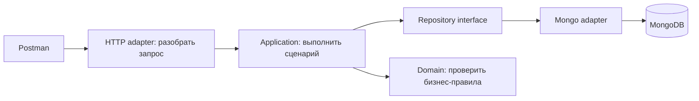

# GeoAssist: как устроен проект и как показать его на защите

Этот туториал объясняет бизнесовую часть Assignment #6. Полный справочник всех технических маршрутов находится в [API-документации](04-api.md). Готовый текст отчёта с местами для изображений — в [Assignment #6 Report](11-assignment-6-report.md).

## 1. Что мы сделали

GeoAssist — бэкенд сервиса поиска мест в Астане. Пользователь может найти кафе, библиотеку, парк или коворкинг, посмотреть карточку, сохранить место в избранное и поставить оценку. Система хранит текущее состояние предпочтений и историю действий.

Сейчас роль интерфейса выполняет Postman. Отдельной веб-страницы, мобильного приложения и работающего рекомендательного алгоритма пока нет. Для шестого задания это нормально: здесь реализуются данные, бизнес-логика и API. На файнале добавим интерфейс и collaborative filtering.

Три главных понятия задания:

| В задании | В GeoAssist |
|---|---|
| Users | Пользователи, выбирающие места |
| Items | Места с координатами, описанием, категорией и тегами |
| Interactions | Просмотр, выбор, избранное, оценка и их изменения |

Связь с диссертацией: будущий алгоритм преобразует фразу «найди тихую кофейню с Wi-Fi в двух километрах от меня» в параметры поиска. Уже написанный бэкенд выполнит такой запрос. Сейчас эти параметры вводим через Postman вручную. Это инфраструктура для диссертации, а не уже готовый перевод естественного языка.

## 2. Что происходит при запуске

В PowerShell, из корня проекта:

```powershell
cd C:\Users\abyla\OneDrive\Desktop\GeoAssist
docker compose up --build -d
docker compose ps
```

Последовательность:

1. Docker запускает MongoDB с постоянным volume для данных.
2. `mongo-init` настраивает replica set `rs0` и ждёт готовности основного узла. После этого контейнер init завершается успешно — это ожидаемо.
3. Go-приложение подключается к базе и применяет валидаторы документов и индексы.
4. Если `AUTO_SEED=true` и набора ещё нет, импортируются демоданные.
5. После успешной подготовки API начинает обслуживать запросы.

Начальный импорт: **100 мест, 50 пользователей + admin, 400 состояний предпочтений и 1200 событий**. Места синтетические: координаты в пределах Астаны, но названия, адреса и характеристики не являются сведениями о реальных заведениях.

Маркер импорта записывается в `app_meta` вместе с данными в одной транзакции. Повторный запуск не добавляет этот набор второй раз. Если запись импорта завершится ошибкой, частично заполненных бизнес-коллекций не останется. После наших тестов документов уже может быть больше — это нормально.

Адрес API — `http://localhost:8080`; MongoDB для подключения с компьютера — `localhost:27018`. Внутри Docker API обращается к `mongo:27017`. Внутренний и внешний адреса различаются.

Проверка готовности:

```powershell
Invoke-RestMethod http://localhost:8080/health/ready
```

Ожидается `status: ready`. Остановка без удаления базы: `docker compose down`.

## 3. Как запрос проходит через Go-код



Это схема выполнения запроса. Зависимости кода направлены внутрь: application знает интерфейс репозитория, а конкретная MongoDB-реализация подключается в bootstrap.

Например, запрос «добавить в избранное» проходит так:

1. Middleware находит текущего пользователя по сессионной cookie.
2. HTTP handler получает ID места из URL и вызывает `SetFavorite`.
3. Application проверяет пользователя, ID и доступность места.
4. В транзакции читается текущее состояние пары пользователь–место.
5. Если место ещё не избранное, состояние меняется и добавляется событие `favorite_added`.
6. После commit формируется JSON-ответ.

Если место уже избранное, возвращается прежнее состояние, без нового события и без изменения времени. Это называется идемпотентностью: повтор одинаковой команды не создаёт новый эффект.

Где искать код:

| Каталог / файл | Что читать |
|---|---|
| [cmd/api/main.go](../cmd/api/main.go) | Подключение БД, подготовка схемы, seed и запуск сервера |
| [internal/bootstrap/bootstrap.go](../internal/bootstrap/bootstrap.go) | Сборка модулей и маршрутов |
| [identity/application/service.go](../internal/identity/application/service.go) | Регистрация, вход и профиль |
| [catalog/application/service.go](../internal/catalog/application/service.go) | Создание, изменение и поиск мест |
| [catalog/adapters/mongo/repository.go](../internal/catalog/adapters/mongo/repository.go) | Реальные MongoDB-запросы, включая геопоиск |
| [activity/application/service.go](../internal/activity/application/service.go) | Избранное, оценки и события |
| [activity/adapters/mongo/repository.go](../internal/activity/adapters/mongo/repository.go) | Транзакции состояния и истории |
| [mongostore/migrations.go](../internal/platform/mongostore/migrations.go) | Валидаторы и индексы |
| [mongostore/seed.go](../internal/platform/mongostore/seed.go) | Детерминированный демонабор Астаны |

**Почему три модели одного объекта?** HTTP DTO описывает то, что отправляет клиент; domain-модель — то, с чем работает бизнес-логика; MongoDB-документ — формат хранения. Например, клиент отправляет `longitude` и `latitude` отдельными полями, а MongoDB хранит их как GeoJSON. Хеш пароля хранится в БД, но не входит в ответ профиля.

## 4. Что хранится в коллекциях

| Коллекция | Простое объяснение |
|---|---|
| `users` | Кто пользователь: email, имя, роль, хеш пароля, предпочтительные категории |
| `sessions` | Какие сессии действуют: хеш токена, пользователь и срок действия |
| `places` | Что можно выбрать: карточки мест и координаты |
| `user_places` | Что пользователь думает о месте сейчас: favorite и rating |
| `interactions` | Что пользователь делал раньше: журнал событий |
| `app_meta` | Служебная отметка, что демонабор уже импортирован |

Документы разных коллекций имеют разные структуры. Внутри одной коллекции мы сами поддерживаем общую схему: проверки в Go плюс MongoDB validators. NoSQL не означает, что любые поля можно бесконтрольно записывать в любой документ. [MongoDB schema validation](https://www.mongodb.com/docs/manual/core/schema-validation/)

**Пример различия состояния и истории:** пользователь поставил 5, затем 4, затем удалил оценку. В `user_places.rating` будет `null`; в истории сохранятся три события. Для первой версии рекомендаций будем использовать актуальное избранное, а не число нажатий кнопки.

Изменение состояния и добавление события объединены в транзакцию. Поэтому не должно получиться «избранное изменилось, а история не записалась». Именно для транзакций здесь используется replica set из одного узла; это не кластер высокой доступности. [MongoDB transactions](https://www.mongodb.com/docs/manual/core/transactions/)

## 5. Подготовка Postman

1. Импортируй [коллекцию](../api/postman/GeoAssist.postman_collection.json) и [environment](../api/postman/GeoAssist.local.postman_environment.json).
2. Выбери `GeoAssist local (demo credentials)`.
3. Проверь `base_url = http://localhost:8080`. `/api/v1` уже есть в URL каждого бизнес-запроса — второй раз его добавлять не нужно.
4. Для скриншотов выполняй запросы **вручную по номерам**, останавливаясь на нужных ответах. Полный Runner удобнее для отдельного общего теста.

Коллекция добавляет `Origin` и `X-GeoAssist-CSRF` для изменяющих запросов. После login Postman сохраняет cookie автоматически. Вставлять Bearer token не требуется.

Есть две роли: `admin` управляет каталогом, `user` — собственными предпочтениями. Смена роли в демонстрации выполняется через logout и login другого аккаунта. Демоаккаунты находятся в [README](../README.md).

После создания места скрипт запроса сохраняет `place_id` и `place_version` в переменные коллекции. После обновления версия обновляется автоматически. Если переменная не подставилась, проверь успешность предыдущего шага и отсутствие одноимённой переменной в environment, перекрывающей значение коллекции.

## 6. Бизнес-сценарий демонстрации

Ниже пути показаны относительно `{{base_url}}/api/v1`. JSON с `{{...}}` — шаблоны Postman, которые подставляются перед отправкой.

### Шаг A. Пользователь и профиль — запросы 06–10

`POST /auth/register` создаёт аккаунт с ролью user. Нельзя самостоятельно передать роль admin. Коллекция генерирует новый email при каждом выполнении запроса 06.

`POST /auth/login` проверяет пароль и создаёт сессию. Это отдельный шаг: регистрация не означает автоматический вход.

`GET /me` возвращает текущий профиль; `PATCH /me` меняет имя и предпочитаемые категории:

```json
{
  "display_name": "Postman Student Updated",
  "preferred_categories": ["library", "cafe"]
}
```

Категории профиля пока не формируют рекомендации автоматически. Они сохраняются как информация о пользователе.

**Для отчёта:** сними успешную регистрацию 06 и изменённый профиль 09. Затем выполни logout 10.

### Шаг B. Администратор создаёт место — запросы 11–13

После admin login 11 отправь `POST /places` (12):

```json
{
  "name": "Postman Demo Coffee",
  "description": "Synthetic place created by the Postman collection.",
  "category": "cafe",
  "tags": ["wifi", "quiet"],
  "address": "Astana, demonstration address",
  "location": {"longitude": 71.4304, "latitude": 51.1282}
}
```

Ответ `201 Created` содержит карточку с новым ID и `version: 1`. Запрос 13, `GET /places/{{place_id}}`, показывает сохранённую карточку. Обрати внимание: название и адрес вымышленные.

**Для отчёта:** на скриншоте 12 должны читаться JSON запроса, статус 201, ID и координаты результата. Это демонстрирует Create, а 13 — Read.

### Шаг C. Изменение карточки — запрос 14

`PATCH /places/{{place_id}}`:

```text
{
  "expected_version": {{place_version}},
  "description": "Updated synthetic place for the API demonstration.",
  "tags": ["quiet", "wifi"]
}
```

Сначала `place_version` равна 1. После успеха возвращается версия 2. Это защита от потери изменений: если два администратора начали редактирование версии 1, после сохранения первого второй получит 409 вместо перезаписи чужой правки.

**Для отчёта:** снимай 14 с `200 OK`, изменённым описанием и новой версией. Не редактируй это место дополнительно перед удалением, если не обновляешь `place_version`.

### Шаг D. Поиск по характеристикам и расстоянию — запрос 15

```text
GET /places?q=postman&category=cafe&tag=wifi&tag=quiet&longitude=71.4304&latitude=51.1282&radius_m=1000
```

Что означает каждый фильтр:

| Параметр | Значение |
|---|---|
| `q=postman` | Название начинается с postman без учёта регистра после нормализации |
| `category=cafe` | Только кафе |
| Два `tag` | У места одновременно есть wifi и quiet |
| `longitude`, `latitude` | Точка, относительно которой ищем |
| `radius_m=1000` | Максимум 1000 метров от точки |

Все условия действуют вместе. Созданное место находится в самой точке поиска, поэтому его расстояние будет нулевым или практически нулевым. Чтобы показать разные расстояния у демокаталога, дополнительно используй запрос 05: он ищет в пределах 5000 метров.

MongoDB хранит `location` как GeoJSON Point с порядком **долгота, широта** и использует индекс `places_geo` типа `2dsphere`. `$geoNear` вычисляет расстояния; результат ограничивается фильтрами и сортируется по расстоянию, затем ID. Это расстояние по сферической модели, не маршрут по улицам. [MongoDB geospatial queries](https://www.mongodb.com/docs/manual/geospatial-queries/)

Без геопараметров `GET /places` работает как обычный каталог. `limit` задаёт размер страницы, `offset` — число пропускаемых результатов. `has_more` сообщает, есть ли следующая страница. Пустая выдача — нормальный ответ 200, а не ошибка.

**Для отчёта:** сними 05 с несколькими distance_m и 15 с комбинированными фильтрами и найденным Postman Demo Coffee. Затем logout 16.

### Шаг E. Избранное — запросы 17–21

Войди demo student через запрос 17. В 18 посмотри состояние созданного места: до первого действия `favorite=false`, `rating=null`.

`PUT /me/favorites/{{place_id}}` (19) без тела делает место избранным:

```json
{
  "data": {
    "place_id": "507f1f77bcf86cd799439011",
    "favorite": true,
    "favorited_at": "2026-11-07T10:00:00Z",
    "rating": null,
    "updated_at": "2026-11-07T10:00:00Z"
  }
}
```

Это иллюстрация формы ответа: фактические ID и время будут другими. Запрос 20 повторяет PUT. В ответе те же отметки времени, нового события нет. Запрос 21 показывает весь список избранных мест текущего пользователя.

**Для отчёта:** сохрани ответы 19 и 20, чтобы были видны одинаковые timestamps. Пользователя сервер определяет по cookie — user_id в JSON не передаётся.

### Шаг F. Оценка — запросы 22–23

`PUT /me/ratings/{{place_id}}` принимает:

```json
{"rating": 5}
```

Потом запрос 23 меняет оценку на 4. В текущем состоянии останется 4; история сохранит оба изменения. Допустимы целые оценки от 1 до 5. Повтор той же оценки не добавляет новое событие.

**Для отчёта:** сними 23: запрос с 4 и ответ с `rating: 4`. Не путай личную оценку с рейтингом всех пользователей — средний рейтинг в MVP не рассчитывается.

### Шаг G. Просмотр, выбор и история — запросы 24–27

`POST /interactions` записывает отдельный факт просмотра:

```json
{
  "event_key": "{{view_event_key}}",
  "place_id": "{{place_id}}",
  "type": "view"
}
```

Запрос 24 создаёт UUID и событие, ответ — 201. Запрос 25 повторяет **тот же event_key** и получает старое событие с 200. Это защита от повторной отправки одного действия. Если снова нажать 24, его скрипт создаст новый ключ — это уже новый просмотр.

Запрос 26 записывает `select`: пользователь выбрал место. Это не означает покупку, бронь или реальное посещение.

`GET /me/interactions?place_id={{place_id}}&limit=100&offset=0` (27) возвращает историю этого места для текущего пользователя. После одного последовательного выполнения 19–26 ожидаются **пять событий**: favorite_added, два rating_set, один view и один select. Порядок в ответе обратный по времени. Повторное избранное и повтор просмотра новых событий не создают.

Открытие карточки через GET не считается просмотром автоматически. События favorite_added и rating_set создаёт сервер при изменении состояния, вручную отправлять их в `/interactions` нельзя.

**Для отчёта:** сними 27 с пятью событиями и разными типами. Здесь хорошо видно, зачем существует отдельная коллекция истории.

### Шаг H. Отмена предпочтений и удаление места — запросы 28–34

- 28: `DELETE /me/ratings/{{place_id}}` очищает текущую оценку.
- 29: `DELETE /me/favorites/{{place_id}}` снимает избранное.
- 30: выход пользователя.
- 31: вход admin.
- 32: `DELETE /places/{{place_id}}?expected_version={{place_version}}` логически удаляет место, ответ 204.
- 33: повторный GET карточки возвращает 404 — это ожидаемый результат, тест считается успешным.
- 34: выход admin.

Физически документ places сохраняется с deleted_at, а история действий остаётся. До отмены и удаления успей снять скриншоты состояния и истории; после них данные будут выглядеть иначе. После 28–29 история места содержит семь событий вместо пяти.

## 7. Как посмотреть это в MongoDB Compass

Подключение:

```text
mongodb://localhost:27018/?replicaSet=rs0&directConnection=true
```

Открой базу geoassist. Для документа созданного места в коллекции places используй фильтр (замени текст на фактический ID из Postman):

```javascript
{ _id: ObjectId("PASTE_ACTUAL_PLACE_ID") }
```

В user_places и interactions фильтруй так:

```javascript
{ place_id: ObjectId("PASTE_ACTUAL_PLACE_ID") }
```

Для этой демонстрационной точки взаимодействовал только demo student, поэтому такой фильтр удобен. В общем случае к нему нужно добавить user_id, чтобы отделить нескольких пользователей.

Состояние снимай **после 23 и до 28**: в user_places должны быть favorite=true и rating=4. В places раскрой location: увидишь GeoJSON, который отличается от HTTP-формы координат.

На вкладке индексов places найди `places_geo` и `2dsphere`. У `user_places` есть уникальный `user_place_unique`; у `interactions` — `event_idempotency`. Их назначение: одна текущая запись на пару пользователь–место и запрет дублирования одного события. На скриншоты не нужно выводить содержимое sessions или password_hash.

## 8. Какие проблемы можно встретить

| Симптом | Что проверить |
|---|---|
| Connection refused | Docker Desktop запущен, API healthy, base_url правильный |
| 401 | Выполнен login нужного аккаунта, cookie jar включён |
| 403 на изменение каталога | Вошёл admin, а не student |
| 403 CSRF_REJECTED | Запрос находится внутри коллекции; Origin совпадает с APP_ORIGIN |
| 409 VERSION_CONFLICT | Перечитай карточку, используй её текущую version |
| 409 EMAIL_ALREADY_EXISTS | Для ручной регистрации возьми новый email |
| 422 | Посмотри error.details: отсутствует поле, неверный радиус или оценка |
| 429 | Подожди Retry-After; не запускай Runner много раз подряд |
| Поиск не находит слово в середине | q — префикс всего названия, не поиск подстроки |
| 404 после шага 32 | Это нормально: карточка логически удалена |

## 9. Что объяснить преподавателю

«Я реализовал слой данных и API для геопространственного помощника. Объекты выбора — места в Астане. MongoDB хранит документы мест с GeoJSON, а 2dsphere обеспечивает геопоиск. Профили, актуальные предпочтения и история разделены. Изменение избранного или оценки и запись соответствующего события атомарны. Архитектура позволяет позднее подключить перевод естественного языка в параметры поиска. На файнале я добавлю item-based collaborative filtering по совместному избранному пользователей».

Не называй текущую сортировку по расстоянию персональными рекомендациями. В первой CF-версии сходство мест будет определяться пересечением пользователей, которым они нравятся; категория и расстояние останутся фильтрами.

## 10. План скриншотов для отчёта

Сохраняй изображения в `docs/screenshots/`. В [отчёте](11-assignment-6-report.md) уже есть блоки для вставки и английские подписи.

| Figure | Файл | Когда и что снимать |
|---|---|---|
| 1 | `01-startup.png` | PowerShell: docker compose ps, API и mongo healthy; рядом готовность API |
| 2a | `02a-place-document.png` | Compass: places, раскрытые category/tags/location/version |
| 2b | `02b-indexes.png` | Compass: places → indexes, places_geo типа 2dsphere |
| 3 | `03-registration.png` | Postman 06: статус 201 и профиль |
| 4 | `04-profile.png` | После login 07: Postman 09, новое имя и категории |
| 5 | `05-create-place.png` | Postman 12: JSON запроса, ответ 201, ID/version/location |
| 6 | `06-update-place.png` | Postman 14: expected_version и новая версия результата |
| 7a | `07a-nearby.png` | Postman 05: координаты/радиус и разные distance_m |
| 7b | `07b-filtered-search.png` | Postman 15: все фильтры и найденное созданное место |
| 8a | `08a-favorite.png` | Postman 19: favorite=true и время |
| 8b | `08b-favorite-repeat.png` | Postman 20: время не изменилось |
| 9 | `09-rating-state.png` | Postman 23: rating=4; до очистки шага 28 |
| 10a | `10a-history.png` | Postman 27: пять событий для созданного места |
| 10b | `10b-current-state-db.png` | Compass: user_places той же точки; после 23, до 28 |
| 11a | `11a-delete.png` | Postman 32: DELETE и статус 204 |
| 11b | `11b-deleted-not-found.png` | Postman 33: GET и статус 404 |
| 12 | `12-test-summary.png` | После отдельного полного Runner: общий итог проверок |

Это рекомендуемые 17 изображений для 12 рисунков, а не установленное преподавателем количество. Если нужен компактный отчёт, объединяй a/b в одно изображение, сохраняя читаемость. Для Figure 7a можно использовать ранний запрос 05; сами номера рисунков отражают структуру отчёта, не требование выполнять запросы в другом порядке.

На Postman-скриншоте должны быть метод, URL/параметры, HTTP-статус и значимые поля ответа. ID и timestamps оставляй настоящими. Не подменяй ответ примерами из текста. Пароли и cookie не нужны для доказательства результата — сворачивай соответствующие панели.

Перед сдачей заполни титульные поля отчёта, вставь изображения, удали русские подсказки редактору и проверь требования преподавателя к конечному формату. В предоставленном PDF перечислено содержание отчёта, но шрифт, поля и межстрочный интервал не заданы.
