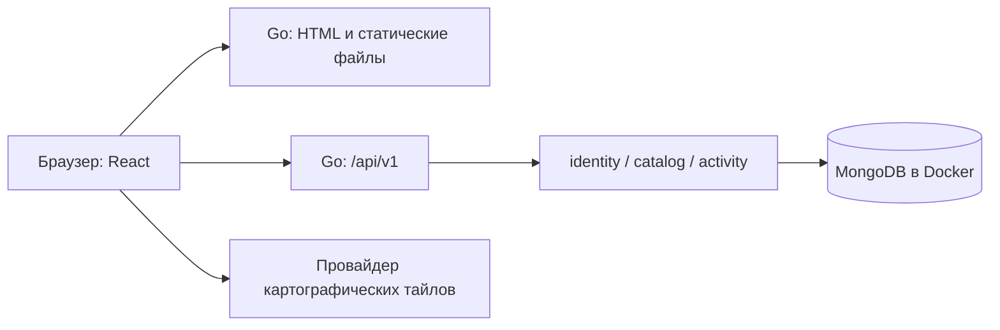

# 13. Архитектура frontend

> Обновление 12.11.2026: frontend реализован. Этот документ сохраняет исходный план; фактическая структура и команды описаны в [руководстве 18](18-frontend-guide.md). Результаты проверок — [документ 19](19-frontend-verification.md).

Статус: план. Обзор решений — [12-frontend-plan.md](12-frontend-plan.md).

## Общая схема



Карта — внешний источник подложки, а не база наших мест. Все карточки, координаты заведений, оценки и избранное поступают из Go API. Браузер не знает MongoDB URI и не содержит пароль базы.

Backend сохраняет существующие domain/application/adapters. На frontend используем более простое разделение по бизнес-областям: страницы собирают интерфейс из модулей, модули вызывают API, общие компоненты ничего не знают о бизнес-сущностях. Не создаём копию серверных репозиториев и use cases для каждого запроса.

## Предлагаемая структура

```text
web/
  package.json
  package-lock.json
  index.html
  vite.config.ts
  tsconfig.json
  public/
  src/
    main.tsx
    app/
      App.tsx
      router.tsx
      providers.tsx
      query-client.ts
      layout/
      guards/                 # RequireSession, RequireAdmin
    pages/
      explore/                # каталог, фильтры, список и карта
      place/                  # карточка + личные действия
      login/
      register/
      profile/
      favorites/
      history/
      admin-places/
      admin-place-editor/     # create/edit используют общую форму
      not-found/
    modules/
      identity/
        api.ts
        queries.ts
        schemas.ts
        components/
        index.ts
      catalog/
        api.ts
        queries.ts
        schemas.ts
        search-params.ts
        components/
        index.ts
      activity/
        api.ts
        queries.ts
        event-recorder.ts
        components/
        index.ts
    shared/
      api/
        generated/schema.d.ts # из api/openapi.yaml, вручную не редактировать
        client.ts             # fetch, заголовки, чтение ответа
        errors.ts
      ui/                     # Button, Field, Alert, Pagination, Dialog
      map/                    # MapCanvas, PointPicker; без API-вызовов
      lib/                    # формат даты/расстояния, координаты
      styles/                 # tokens.css, global.css
  tests/
    e2e/
  dist/                       # результат сборки, не исходники
internal/platform/webui/      # будущий Go adapter раздачи web/dist
```

Тесты небольших функций можно размещать рядом с кодом (`*.test.ts`). Не создаём пустые папки заранее: добавляем их вместе с кодом соответствующего этапа.

## Правила зависимостей

- `app` подключает страницы, QueryClient и session provider.
- `pages` объединяют несколько модулей. Например, карточка соединяет `catalog` и `activity`.
- `modules/*` используют `shared`; не импортируют страницы и app.
- Прямые зависимости одного бизнес-модуля от другого исключаем: нужные ID, компоненты и callbacks связывает страница. Типы вложенных DTO доступны из общей OpenAPI-схемы.
- `shared/ui` не делает сетевые запросы. `shared/map` получает координаты и callbacks через props.
- Компоненты не вызывают `fetch` напрямую: `component → query/mutation hook → module/api.ts → shared/api/client.ts`.
- Скрытая кнопка админа улучшает интерфейс; реальную проверку роли по-прежнему выполняет Go.

Пример: пользователь нажимает звезду → activity mutation отправляет `PUT /me/ratings/:id` → ответ обновляет состояние места → Query помечает избранное и историю устаревшими → связанные экраны перечитывают данные.

## Модели данных

Типы `User`, `Place`, `UserPlaceState`, `Favorite`, `Interaction`, ошибки и пагинацию берём из OpenAPI. Генератор создаёт типы, но не проверяет JSON во время выполнения; сетевой клиент отдельно проверяет форму обёртки ответа. [openapi-typescript](https://openapi-ts.dev/introduction).

В DTO сохраняем `snake_case`, чтобы связь с API была очевидной. UI-модели вводим только там, где представление действительно отличается: строка радиуса в форме, подпись даты, состояние загрузки, точка Leaflet. Не копируем все сущности в параллельную систему классов.

Zod-схемы описывают пользовательский ввод. Сервер остаётся последней инстанцией проверки правил. Даты сохраняем в кэше как строки RFC3339, форматируем при отображении; nullable поля не превращаем в фиктивные нули.

## Статика в Go

Выбор: каталог сборки на диске, путь через будущую переменную `WEB_DIR`. Это позволяет собирать и тестировать Go API без предварительной установки Node.

В Docker добавляем этап Node-сборки, затем копируем `web/dist` в `/app/web` runtime-образа. В нём по-прежнему работает Go; `WEB_DIR=/app/web`. Существующие бинарники migrate/seed/create-admin, инициализация MongoDB и volume сохраняются.

Go adapter `webui` должен:

- обслуживать HTML и файлы только при настроенном `WEB_DIR`; если явно указанный каталог отсутствует, сообщать об ошибке конфигурации при запуске;
- отдавать `index.html` для клиентских страниц при GET/HEAD; обновление `/places/:id` в браузере должно работать;
- сохранять JSON 404/405 для `/api`, `/api/*`, `/health` и `/health/*`; неизвестный API не должен возвращать HTML;
- для отсутствующего `/assets/*` и запросов файлов возвращать 404, а не SPA;
- запрещать выход за пределы static root и листинг каталогов;
- отдавать `index.html` с перепроверкой кэша, а файлы с хешем в имени — с длительным immutable-кэшированием;
- не менять существующие handlers и серверные бизнес-правила.

При пустом `WEB_DIR` остаётся прежний режим API-only. Fallback маршрутов — отдельная часть adapter, а не безусловная замена любого ответа 404.

## Режимы запуска

Это целевая конфигурация после реализации, не готовые сейчас команды.

| Режим | Адрес в браузере | Как идут запросы | APP_ORIGIN |
|---|---|---|---|
| Docker / демонстрация | `http://localhost:8080` | Go раздаёт frontend и API | `http://localhost:8080` |
| Разработка frontend | `http://localhost:5173` | Vite проксирует `/api` и `/health` на `http://127.0.0.1:8080` | `http://localhost:5173` |
| API-only / Postman | API на `http://localhost:8080` | Как сейчас | Настроенное значение backend |

Vite: фиксированный порт 5173, `strictPort: true`, только локальный доступ. Proxy сохраняет исходный `Origin`, не подставляет доверенный origin вместо клиентского. Браузер всегда вызывает относительный `/api/v1`, поэтому для него запросы same-origin. Возможность proxy и фиксации порта описана в [Vite Server Options](https://vite.dev/config/server-options).

При переключении на Vite backend нужно перезапустить/пересоздать с новым `APP_ORIGIN`; изменения `.env` сами не перенастраивают работающий контейнер. Для Postman в этом режиме значение `origin` также должно быть 5173. Возвращаясь к обычному Docker-запуску, возвращаем 8080. Не смешиваем `localhost` и `127.0.0.1` в браузерных URL: для cookie и Origin это разные hosts.

Не разрешаем произвольный CORS и не отключаем CSRF. Внешняя публикация с HTTPS — отдельная конфигурация, а не изменение локальных cookie по умолчанию.

